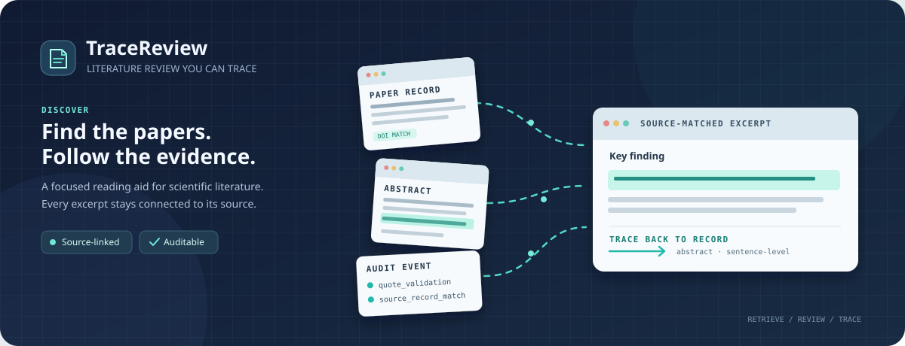
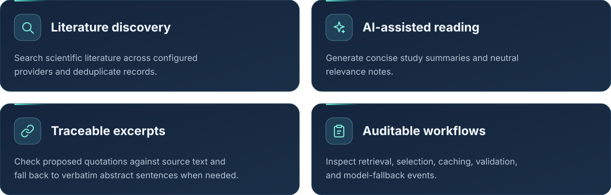
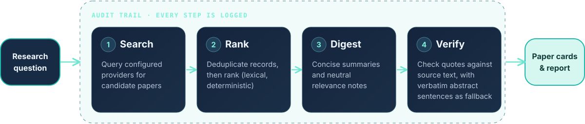
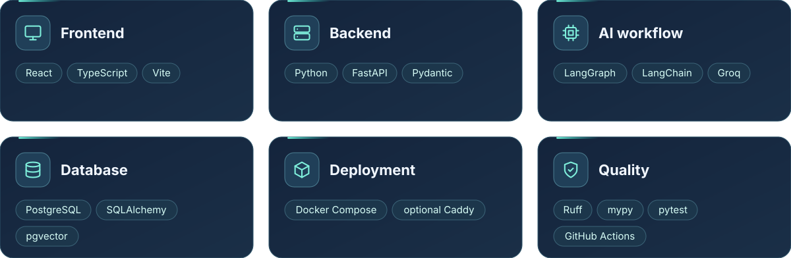

<div align="center">



<br />
<br />


<!-- Add once a LICENSE file exists (adjust the license name):

-->
<!-- CI badge: confirm the workflow filename in .github/workflows/ first
<a href="https://github.com/samavinasir/tracereview/actions"></a>
-->

<br />
<br />

**Discover scientific papers. Inspect source-matched excerpts.**
<br />
**Keep the research 
 auditable.**

<br />

[](#features)
[](#workflow)
[](#quick-start)
[](#configuration)
[](#roadmap)

</div>

<br />

<a name="why"></a>


> AI-generated literature summaries are useful, but researchers need to inspect the sources behind them.

TraceReview combines **literature discovery**, **AI-assisted reading**, **source-matched excerpts**, and **workflow auditing** in one application, so every claim can be followed back to the paper it came from.

<br />

<!--
## Screenshots

Add a real UI screenshot or short GIF here: a search, a paper card, and the audit trail.
This is the single biggest credibility boost for the page.

<div align="center">


</div>

<br />
-->

<a name="features"></a>


<br />

<a name="workflow"></a>


<br />

<a name="tech-stack"></a>


<a name="tech-stack"></a>


<br />

<a name="quick-start"></a>


**Prerequisites:** [Docker](https://docs.docker.com/get-docker/) with Docker Compose, and a [Groq API key](https://console.groq.com/).

**1. Clone the repository**

```bash
git clone https://github.com/samavinasir/tracereview.git
cd tracereview
```

**2. Configure the environment**

Copy `.env.example` to `.env`, then set `GROQ_API_KEY` and your database password.

```bash
cp .env.example .env
```

**3. Start everything**

```bash
docker compose up --build -d
```

**4. Open the app**

- 🌐&nbsp; **Web app:** http://localhost:5173
- 📖&nbsp; **API docs:** http://localhost:8000/docs
- 💚&nbsp; **Health check:** http://localhost:8000/health

<br />

<a name="configuration"></a>


Settings live in `.env` (start from `.env.example`).

| Variable | Required | Purpose |
|:--|:--:|:--|
| `GROQ_API_KEY` | Yes | API key for the Groq-hosted models used for summaries and excerpt selection. |
| *Database password* | Yes | Password for the PostgreSQL container. <!-- replace with the exact variable name from .env.example --> |

<br />

<a name="development"></a>


```bash
# Lint and format check
ruff check .

# Type checking
mypy src

# Tests
pytest
```

<!-- Add the frontend commands too, e.g. cd frontend && npm install && npm run dev -->

For production, use `docker-compose.prod.yml` (with the optional Caddy reverse proxy).

<br />

<a name="important-notes"></a>


> [!WARNING]
> TraceReview is under active development. Please keep these limitations in mind:
>
> - Ranking is currently deterministic and lexical; embedding-based ranking is not implemented.
> - Excerpt matching checks wording, not scientific truth.
> - Research runs cannot resume after an API restart.

<br />

<a name="roadmap"></a>


- [ ] Embedding-based ranking (pgvector is already part of the stack)
- [ ] Resumable research runs that survive an API restart
- [ ] Exportable reports (Markdown / PDF)
- [ ] Additional literature providers

<br />

<a name="license"></a>


<!-- Add a LICENSE file first (MIT or Apache-2.0 are common), then state it here. -->
See [LICENSE](LICENSE) for details.

<br />

---

<div align="center">

**Discover carefully. Read critically. Trace every excerpt.**

<sub>Built for researchers who want more transparent literature workflows.</sub>

</div>