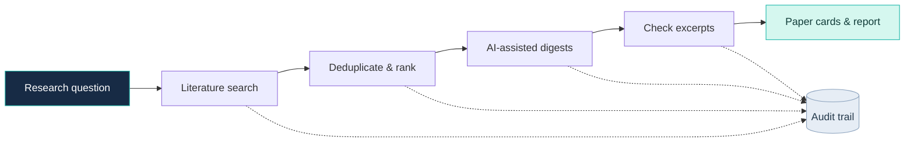

 <div align="center">

  

  <h1>TraceReview</h1>

  <p><strong>Literature review you can trace.</strong></p>

  <p>Discover scientific papers. Inspect source-matched excerpts. Keep the research workflow auditable.</p>

  
  
  
  

  <p>
    <a href="#features">Features</a> ·
    <a href="#workflow">Workflow</a> ·
    <a href="#tech-stack">Tech stack</a> ·
    <a href="#quick-start">Quick start</a>
  </p>

</div>

---

## Why TraceReview?

AI-generated literature summaries are useful, but researchers need to inspect the sources behind them.

TraceReview combines literature discovery, AI-assisted reading, source-matched excerpts, and workflow auditing in one application.

## Features

<table>
<tr>
<td width="50%" valign="top">

### 🔎 Literature discovery
Search scientific literature across configured providers and deduplicate records.

</td>
<td width="50%" valign="top">

### 🧠 AI-assisted reading
Generate concise study summaries and neutral relevance notes.

</td>
</tr>
<tr>
<td width="50%" valign="top">

### 🔗 Traceable excerpts
Check proposed quotations against source text and fall back to verbatim abstract sentences when needed.

</td>
<td width="50%" valign="top">

### 📋 Auditable workflows
Inspect retrieval, selection, caching, validation, and model-fallback events.

</td>
</tr>
</table>

## Workflow



## Tech stack

| Layer | Technologies |
|---|---|
| Frontend | React, TypeScript, Vite |
| Backend | Python, FastAPI, Pydantic |
| AI workflow | LangGraph, LangChain, Groq |
| Database | PostgreSQL, SQLAlchemy, pgvector |
| Deployment | Docker Compose, optional Caddy |
| Quality | Ruff, mypy, pytest, GitHub Actions |

## Quick start

```bash
git clone https://github.com/samavinasir/tracereview.git
cd tracereview
```

Copy `.env.example` to `.env`, configure `GROQ_API_KEY` and your database password, then run:

```bash
docker compose up --build -d
```

| Service | URL |
|---|---|
| Web app | http://localhost:5173 |
| API docs | http://localhost:8000/docs |
| Health check | http://localhost:8000/health |

## Important notes

- Ranking is currently deterministic and lexical; embedding-based ranking is not implemented.
- Excerpt matching checks wording, not scientific truth.
- Research runs cannot resume after an API restart.

---

<div align="center">

**Discover carefully. Read critically. Trace every excerpt.**

<sub>Built for researchers who want more transparent literature workflows.</sub>

</div>
