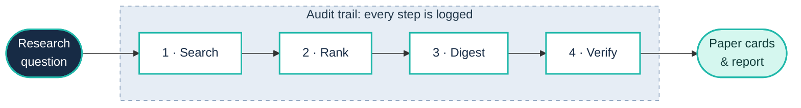

<div align="center">


<br />
<br />


<br />
<br />

**Discover scientific papers. Inspect source-matched excerpts.**
<br />
**Keep the research workflow auditable.**

<br />

[](#features)
[](#workflow)
[](#tech-stack)
[](#quick-start)

</div>

<br />

## Why TraceReview?

> AI-generated literature summaries are useful, but researchers need to inspect the sources behind them.

TraceReview combines **literature discovery**, **AI-assisted reading**, **source-matched excerpts**, and **workflow auditing** in one application, so every claim can be followed back to the paper it came from.

<br />

## Features

<table>
<tr>
<td width="50%" valign="top">

#### 🔎&nbsp; Literature discovery

Search scientific literature across configured providers and deduplicate records.

</td>
<td width="50%" valign="top">

#### 🧠&nbsp; AI-assisted reading

Generate concise study summaries and neutral relevance notes.

</td>
</tr>
<tr>
<td width="50%" valign="top">

#### 🔗&nbsp; Traceable excerpts

Check proposed quotations against source text and fall back to verbatim abstract sentences when needed.

</td>
<td width="50%" valign="top">

#### 📋&nbsp; Auditable workflows

Inspect retrieval, selection, caching, validation, and model-fallback events.

</td>
</tr>
</table>

<br />

## Workflow

From question to report in four steps. Everything inside the highlighted band is written to the audit trail.



<table>
<tr>
<td width="25%" valign="top">

**1 · Search**

Query configured providers and collect candidate papers.

</td>
<td width="25%" valign="top">

**2 · Rank**

Deduplicate records, then rank them (lexical and deterministic).

</td>
<td width="25%" valign="top">

**3 · Digest**

Generate concise summaries and neutral relevance notes.

</td>
<td width="25%" valign="top">

**4 · Verify**

Check quotes against source text; fall back to verbatim abstract sentences.

</td>
</tr>
</table>

<sub>The audit trail covers retrieval, selection, caching, validation, and model-fallback events.</sub>

<br />

## Tech stack

<table>
<tr>
<td width="33%" valign="top">

**🖥️&nbsp; Frontend**

React · TypeScript · Vite

</td>
<td width="33%" valign="top">

**⚙️&nbsp; Backend**

Python · FastAPI · Pydantic

</td>
<td width="33%" valign="top">

**🤖&nbsp; AI workflow**

LangGraph · LangChain · Groq

</td>
</tr>
<tr>
<td width="33%" valign="top">

**🗄️&nbsp; Database**

PostgreSQL · SQLAlchemy · pgvector

</td>
<td width="33%" valign="top">

**🐳&nbsp; Deployment**

Docker Compose · optional Caddy

</td>
<td width="33%" valign="top">

**✅&nbsp; Quality**

Ruff · mypy · pytest · GitHub Actions

</td>
</tr>
</table>

<br />

## Quick start

**1. Clone the repository**

```bash
git clone https://github.com/samavinasir/tracereview.git
cd tracereview
```

**2. Configure the environment**

Copy `.env.example` to `.env`, then set `GROQ_API_KEY` and your database password.

```bash
cp .env.example .env
```

**3. Start everything**

```bash
docker compose up --build -d
```

**4. Open the app**

| Service | URL |
|:--|:--|
| 🌐&nbsp; Web app | http://localhost:5173 |
| 📖&nbsp; API docs | http://localhost:8000/docs |
| 💚&nbsp; Health check | http://localhost:8000/health |

<br />

## Important notes

> [!WARNING]
> TraceReview is under active development. Please keep these limitations in mind:
>
> - Ranking is currently deterministic and lexical; embedding-based ranking is not implemented.
> - Excerpt matching checks wording, not scientific truth.
> - Research runs cannot resume after an API restart.

<br />

---

<div align="center">

**Discover carefully. Read critically. Trace every excerpt.**

<sub>Built for researchers who want more transparent literature workflows.</sub>

</div>
