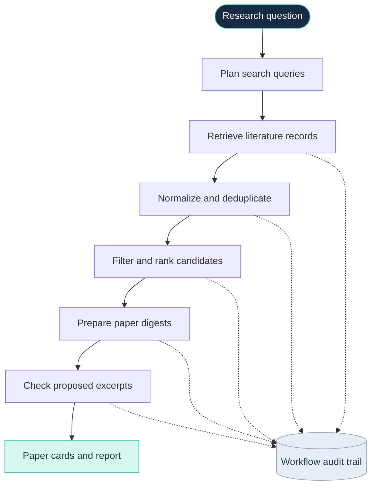
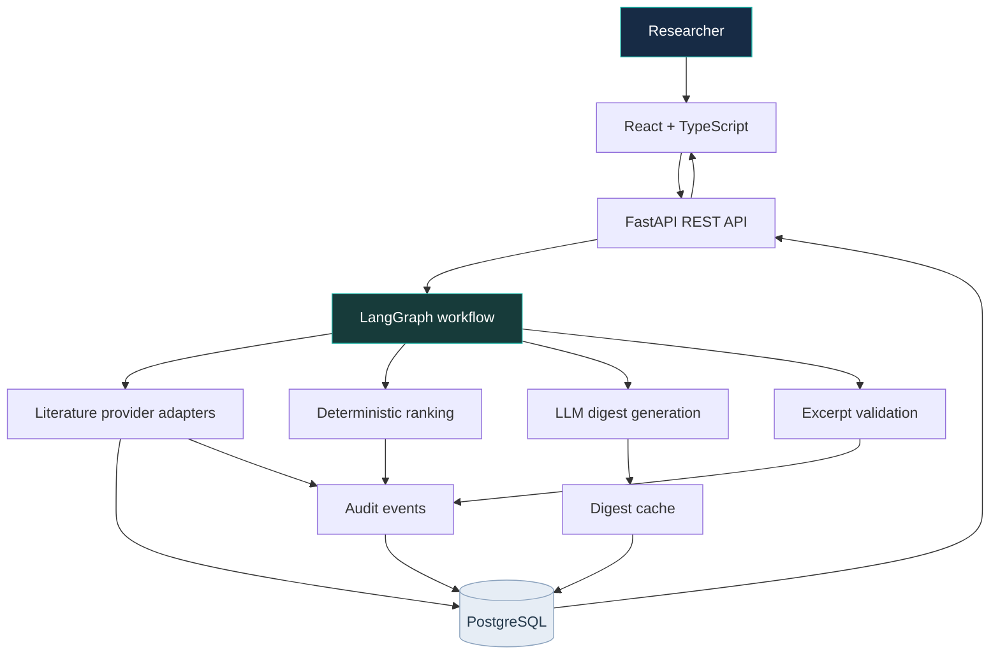

 <div align="center">

  

  <h1>TraceReview</h1>

  <p><strong>Literature review you can trace.</strong></p>

  <p>
    Discover relevant scientific papers, inspect what each source says, and trace reading notes back to their original records.
  </p>

  <p>
    
    
    
    
    
  </p>

  <p>
    <a href="#why-tracereview">Why TraceReview</a> ·
    <a href="#key-capabilities">Capabilities</a> ·
    <a href="#architecture">Architecture</a> ·
    <a href="#quick-start">Quick start</a> ·
    <a href="#limitations">Limitations</a>
  </p>

</div>

---

## Why TraceReview?

Finding scientific papers is only the beginning of a literature review. Researchers still need to determine which studies are relevant, understand what each study reports, and return to the original source to inspect the evidence.

AI can accelerate that process, but a fluent summary is not a substitute for source inspection.

**TraceReview is an AI-assisted literature discovery and reading workspace built around traceability.**

It retrieves scientific literature, ranks candidate records using a deterministic lexical approach, prepares concise reading aids with an LLM, checks proposed excerpts against source text, and records workflow events so researchers can inspect how a research run progressed.

The objective is not to automate scientific judgment. It is to make the process of finding and examining literature more structured, transparent, and useful.

> **A reading aid, not a scientific judge.** TraceReview helps researchers navigate literature. Researchers remain responsible for evaluating the methods, evidence, limitations, and conclusions of the original studies.

## At a glance

| Capability | What it does |
| --- | --- |
| Literature discovery | Searches configured scientific literature providers |
| Record normalization | Deduplicates matching records while retaining alternate source links |
| Deterministic ranking | Prioritizes candidates using lexical relevance rather than embedding similarity |
| AI-assisted reading | Produces concise study summaries and neutral retrieval notes |
| Excerpt checking | Checks proposed quotations against cleaned source text |
| Audit trail | Records important retrieval, selection, cache, and model events |
| Persistent digest cache | Reuses successful digests when the relevant inputs and prompt version match |
| Research scope awareness | Flags records whose named organism differs from the requested research scope |

## Product preview

TraceReview is designed around three connected views of the research process:

1. **Research workspace:** enter a research question and inspect the progress of a literature search.
2. **Paper cards:** examine bibliographic details, concise summaries, source links, and matched excerpts.
3. **Audit trail:** inspect workflow events, quotation checks, cache activity, and model fallbacks.

<!--
TODO: Add screenshots captured from the actual running application.

Suggested assets:
- assets/screenshots/research-workspace.png
- assets/screenshots/paper-card.png
- assets/screenshots/audit-trail.png

Use the same dark navy and mint visual identity as the hero.
Do not use mock screenshots as evidence of implemented functionality.
-->

## Key capabilities

### 01 · Discover relevant literature

Search configured literature providers using a research question and planned search queries.

- PubMed and Europe PMC are the default literature sources.
- OpenAlex and Semantic Scholar are optional adapters.
- Crossref is available as an adapter but is not enabled by default.
- UniProt adapter support is available for relevant source workflows.

Provider availability, response quality, and record completeness can vary.

### 02 · Normalize and deduplicate records

Different providers may return the same paper with different metadata or source links.

TraceReview merges matching records using identifiers such as PMID and DOI, with normalized titles used for matching where appropriate. Alternate provider links are retained so researchers can return to the source records.

### 03 · Rank candidates transparently

The current ranking approach is deterministic and lexical.

It prioritizes candidate records using textual relevance rather than an embedding-based semantic search system.

The default research run is capped at 10 unique records, and the interface displays up to 10 paper cards.

These limits keep the current workflow focused and bounded. They do not imply exhaustive literature coverage.

### 04 · Prepare structured reading aids

Each selected paper can include:

- Bibliographic metadata and source links.
- A concise, AI-generated summary of the study.
- A neutral note explaining its relevance to the research question.
- Up to two proposed key-finding excerpts checked against source text.
- The final sentence of the abstract copied from the source record.

These elements help researchers navigate a paper. They should not be treated as independently verified scientific conclusions.

### 05 · Check proposed excerpts against sources

LLM-generated quotations can contain subtle wording changes or combine statements from different parts of a text.

TraceReview checks proposed excerpts against cleaned source text. If the proposed quotations do not match, the workflow can fall back to relevant abstract sentences copied verbatim from the source record.

**Text matching verifies wording, not scientific truth.** A correctly matched sentence can still be incomplete, misleading without context, or insufficient to support a broader claim.

### 06 · Inspect workflow events

TraceReview records events associated with important workflow stages, including:

- Provider retrieval.
- Record selection.
- Model and cache activity.
- Quotation validation.
- Model fallback and failure handling.

The audit trail makes workflow behavior easier to inspect and debug. It does not, by itself, establish scientific reproducibility or guarantee that every external provider response is preserved permanently.

### 07 · Reuse successful digests

Successful paper digests can be cached in PostgreSQL when the paper text, research question, and prompt version match.

This avoids repeating some model calls when the relevant inputs have not changed.

Failed summaries remain visibly unreviewed instead of being silently presented as successful scientific findings.

---

## How it works



### Workflow stages

1. **Plan and retrieve.** The workflow prepares search queries and retrieves records from configured literature providers.
2. **Normalize and select.** Matching records are deduplicated, unsuitable record types and short abstracts are filtered, and remaining candidates are ranked deterministically.
3. **Prepare reading aids.** Selected records are processed in batches to generate concise summaries and proposed excerpts.
4. **Validate and report.** Excerpts are checked against cleaned source text, successful digests may be cached, and available results are presented as paper cards and a report.
5. **Record events.** Important provider, selection, model, cache, and validation events are recorded for inspection.

The current implementation uses LangGraph for workflow orchestration and an LLM for digest generation. Not every stage is an autonomous agent: record normalization, ranking, matching, and other deterministic operations remain conventional application logic.

## Architecture



### Technology stack

| Layer | Technologies |
| --- | --- |
| Frontend | React 19, TypeScript, Vite 6, Lucide React |
| API | Python 3.11+, FastAPI, Pydantic Settings, Uvicorn |
| Workflow orchestration | LangGraph |
| LLM integration | LangChain Groq integration |
| Default model provider | Groq GPT-OSS |
| Optional fallback | OpenRouter free-router configuration |
| Literature sources | PubMed/NCBI, Europe PMC, OpenAlex, Semantic Scholar |
| Additional adapters | Crossref, UniProt |
| Database | PostgreSQL 16, SQLAlchemy asyncio, asyncpg |
| Vector extension | pgvector |
| Deployment | Docker Compose, optional Caddy HTTPS reverse proxy |
| Quality checks | Ruff, mypy, pytest |
| CI | GitHub Actions for linting, typing, tests, and image builds |

**Implementation note:** pgvector is installed and the database schema can store embeddings, but the current research workflow does not download or use an embedding model for ranking. The presence of pgvector should not be interpreted as active vector search.

---

## Quick start

### Prerequisites

Install the following before starting:

- Docker Engine or Docker Desktop with Docker Compose.
- A Groq API key for the default digest-generation provider.
- Git to clone the repository.

### 1. Clone the repository

```bash
git clone https://github.com/samavinasir/tracereview.git
cd tracereview
```

### 2. Configure environment variables

Create a local environment file from the example:

**PowerShell**

```powershell
Copy-Item .env.example .env
```

**Linux / macOS**

```bash
cp .env.example .env
```

Configure `GROQ_API_KEY` and a database password in `.env`.

Keep `POSTGRES_PASSWORD`, `DATABASE_URL`, and `DATABASE_URL_DOCKER` consistent with your configuration. The database hostname in the Docker connection URL should be `db`.

Optional provider settings include:

- `OPENROUTER_API_KEY`
- `NCBI_API_KEY`
- `CONTACT_EMAIL`
- `SEMANTIC_SCHOLAR_API_KEY`

Refer to `.env.example` for the supported settings and their defaults.

> **Security:** Never commit `.env` or publish API keys, database credentials, or other secrets in screenshots, logs, or public issues. URL-encode special characters in passwords embedded in database connection URLs.

### 3. Build and start the application

```powershell
docker compose up --build -d
```

### 4. Open TraceReview

| Service | Local URL |
| --- | --- |
| Web interface | [http://localhost:5173](http://localhost:5173) |
| API health check | [http://localhost:8000/health](http://localhost:8000/health) |
| Interactive API documentation | [http://localhost:8000/docs](http://localhost:8000/docs) |

Check container status:

```powershell
docker compose ps
```

Follow application logs:

```powershell
docker compose logs -f api frontend
```

The PostgreSQL database uses the `research_pgdata` Docker volume. Running `docker compose down` preserves the database volume. Avoid `docker compose down -v` unless you intentionally want to delete the local database data.

---

## Configuration

TraceReview reads most configuration from environment variables, usually through `.env`.

<details>
<summary><strong>Model providers and throughput</strong></summary>

- `GROQ_API_KEY`, `GROQ_MODEL`, `GROQ_REASONING_EFFORT`, and `GROQ_TPM_BUDGET` configure Groq.
- `OPENROUTER_API_KEY` and `OPENROUTER_FALLBACK_MODEL` configure an independent digest fallback attempt.
- Groq digest requests use a process-local concurrency limit and token budget.
- Long provider cooldowns are not retried indefinitely.
- If both providers fail, the workflow records the issue and continues with whatever cards are available.

</details>

<details>
<summary><strong>Literature sources and retrieval limits</strong></summary>

- `NCBI_API_KEY`, `CONTACT_EMAIL`, and `SEMANTIC_SCHOLAR_API_KEY` configure optional provider settings.
- `MAX_RECORDS_PER_RESEARCH_RUN` and `MAX_PAPERS_PER_REVIEW` control retrieval and review limits.
- `MIN_ABSTRACT_CHARS` controls the minimum abstract length.
- `PAPER_DIGEST_BATCH_SIZE` controls digest batching.
- Search requests use bounded concurrency, and PubMed calls are paced separately.
- The workflow can expand retrieval once if too few cards are available. A model summarization failure alone does not trigger broader retrieval.

</details>

<details>
<summary><strong>Database connection</strong></summary>

- `DATABASE_URL` configures database access.
- `DATABASE_URL_DOCKER` is used for the Docker network configuration.
- `POSTGRES_PASSWORD` configures the database password.
- The Docker database hostname should be `db`.

Back up the PostgreSQL volume before database upgrades or migrations.

</details>

---

## API reference

The following endpoints expose research runs and their associated records.

| Method | Endpoint | Purpose |
| --- | --- | --- |
| `GET` | `/health` | API health check |
| `POST` | `/research` | Start a research run and return a run ID |
| `GET` | `/research/{id}` | Retrieve run details |
| `GET` | `/research/{id}/status` | Inspect run status and progress |
| `GET` | `/research/{id}/plan` | Retrieve the research objective and search plan |
| `GET` | `/research/{id}/sources` | Retrieve source records and paper summaries |
| `GET` | `/research/{id}/report` | Retrieve report JSON |
| `GET` | `/research/{id}/report?format=markdown` | Retrieve a Markdown report |
| `GET` | `/research/{id}/audit` | Inspect workflow events and diagnostics |

Interactive endpoint documentation is available at `/docs` when the API is running.

Legacy evidence and claims endpoints remain for compatibility with older stored runs. New research runs use paper cards and do not generate or verify scientific claims.

---

## Local development

### Backend

Create and activate a Python virtual environment from the repository root.

**Windows PowerShell**

```powershell
python -m venv .venv
.\.venv\Scripts\Activate.ps1
pip install -e ".[dev]"
```

Run the backend quality checks:

```powershell
ruff check src tests
mypy src
pytest -q
```

Start the API:

```powershell
uvicorn auditable_research.api:app --app-dir src --reload
```

### Frontend

Open another terminal:

```powershell
cd frontend
npm install
npm run dev
```

The frontend runs at [http://localhost:5173](http://localhost:5173).

Set `VITE_API_BASE_URL` if the API is hosted at a different address.

---

## Production deployment

The optional `docker-compose.prod.yml` configuration adds Caddy as an HTTPS reverse proxy.

The documented deployment target is a Linux VM with:

- Docker Compose v2.24 or newer.
- DNS records for the UI and API domains pointing to the VM.
- Inbound TCP ports 80 and 443 open.
- Strong database credentials and configured model-provider credentials.

Configure `UI_DOMAIN`, `API_DOMAIN`, and the required secrets in the VM's `.env` file.

Start the production configuration:

```bash
docker compose \
  -f docker-compose.yml \
  -f docker-compose.prod.yml \
  up -d --build
```

### Production security

The production Compose configuration sets `FORWARDED_ALLOW_IPS=*` so Uvicorn can interpret forwarded client addresses from Caddy.

This configuration is safe only when the API is not directly exposed and Caddy is the trusted entry point. If the API is exposed directly, remove that setting or restrict trusted proxy addresses appropriately to avoid trusting spoofed forwarding headers.

Review the deployment configuration, access controls, secret management, and backup strategy before exposing the application to untrusted traffic.

---

## Limitations

TraceReview is under active development. Its current design has important operational and methodological boundaries.

| Area | Current limitation |
| --- | --- |
| Literature coverage | Retrieval is bounded and depends on configured providers and available metadata. It is not an exhaustive systematic-review search. |
| Ranking | Ranking is deterministic and lexical; embedding-based semantic ranking is not currently used. |
| Excerpt validation | Matching checks wording against source text, not the truth or context of scientific claims. |
| Abstract-based evidence | Some records may have only abstracts available, limiting the detail of the reading aids. |
| Background execution | Research runs execute inside the API process and cannot resume after an API restart. |
| Horizontal scaling | Background jobs and rate limits are process-local; multiple API replicas require additional infrastructure. |
| Audit trail | Recorded workflow events improve inspection but do not guarantee complete, immutable, or independently tamper-proof records. |
| AI output | Summaries and retrieval notes can omit nuance or misinterpret a study. Human review remains necessary. |

### Background jobs and recovery

The initial deployment targets a single API container. If the API restarts during a research run, that run cannot resume. On startup, runs still marked `queued` or `running` are marked `failed` with an explanatory message so they can be restarted.

Before scaling to multiple API replicas, the application needs a durable background-job queue and shared rate limiting. PostgreSQL persistence alone does not make in-flight workflow execution resumable.

---

## Project principles

<div align="center">

| Principle | What it means |
| --- | --- |
| **Source before summary** | Keep source records and excerpts inspectable. |
| **Verbatim means verbatim** | Check proposed excerpts against cleaned source text. |
| **Failures stay visible** | Do not silently present failed digests as successful findings. |
| **Retrieval is not verification** | Finding a paper does not establish that its claims are correct. |
| **AI supports researchers** | Keep scientific interpretation and final decisions with the researcher. |

</div>

## Roadmap

The following are potential future improvements, not claims about existing functionality.

- [ ] Add a screenshot-based product walkthrough and short demo.
- [ ] Evaluate retrieval and ranking against a curated set of research questions and relevant papers.
- [ ] Explore embedding-based retrieval and compare it with the current lexical baseline.
- [ ] Add durable background jobs and recovery for interrupted research runs.
- [ ] Introduce shared rate limiting before supporting multiple API replicas.
- [ ] Expand test coverage for provider failures, cache invalidation, and excerpt matching.
- [ ] Improve the export and review experience for researchers working with larger literature collections.

## Contributing

TraceReview is actively being developed, and improvements to reliability, usability, retrieval quality, testing, and documentation are valuable.

If you find a bug or have a feature suggestion, open an issue in the [GitHub repository](https://github.com/samavinasir/tracereview). Include reproducible steps, relevant logs with secrets removed, and the expected behavior where possible.

## License

Check the repository's `LICENSE` file for the applicable license and terms of use.

---

<div align="center">

  <p><strong>TraceReview</strong></p>

  <p>Discover carefully. Read critically. Trace every excerpt.</p>

  <sub>Built to help researchers work with literature more transparently, one source at a time.</sub>

  <br />

  <a href="https://github.com/samavinasir/tracereview">Explore the repository</a>

</div>
