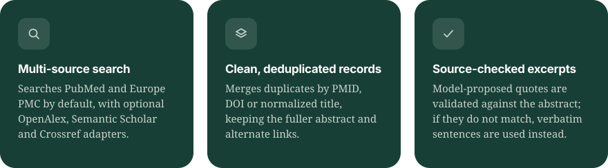
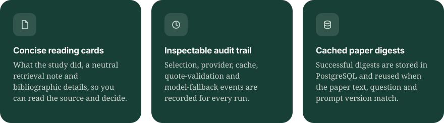

<p align="center">
  
</p>

<p align="center">
  <a href="https://tracereview.vercel.app"></a>
  <a href="LICENSE"></a>
</p>

<p align="center">
  
  
  
  
  
</p>

<p align="center">
  <a href="#features">Features</a> &nbsp;·&nbsp;
  <a href="#workflow">Workflow</a> &nbsp;·&nbsp;
  <a href="#tech-stack">Tech stack</a> &nbsp;·&nbsp;
  <a href="#run-locally">Run locally</a> &nbsp;·&nbsp;
  <a href="#configuration">Configuration</a> &nbsp;·&nbsp;
  <a href="#api-overview">API</a> &nbsp;·&nbsp;
  <a href="#production-notes">Production</a>
</p>

<br>

**TraceReview** helps researchers find a focused set of papers and read what each source says. Enter a research question to retrieve and rank records, then review paper cards with bibliographic details, a short AI-generated study summary, checked verbatim excerpts, and the abstract's final sentence copied from the source record.

> [!IMPORTANT]
> TraceReview does not decide whether a paper's conclusions are true and does not produce scientific verdicts. AI summaries and retrieval notes are reading aids and may miss nuance. Read the linked paper and decide what the findings mean.

<br>

<a id="features"></a>
<p align="center"></p>

<p align="center">
  <br>
  
</p>

<details>
<summary><b>Everything else it does</b></summary>

<br>

- Filters theses, dissertations and short abstracts before ranking. The default run cap is 10 unique records, and the UI shows up to 10 paper cards.
- Cleans HTML/XML markup before displaying source text and validating quotes.
- Ranks records by overlap with the words in the research question, and records why an item was selected or excluded.
- Offers discipline and review-goal options, year/source/full-text filters, and a paper-first screening view with saved include/exclude decisions and reviewer notes.
- Shows source-linked evidence excerpts alongside the paper, and exports a Markdown digest.
- Separates the spacious new-search home, the research Results workspace, and the live Run details page (progress, search plan and audit details).

</details>

<br>

<a id="workflow"></a>
<p align="center"></p>

<p align="center"></p>

Successful summaries are cached; failed summaries stay visibly unreviewed and do not become scientific findings. Search requests use bounded concurrency: PubMed calls are paced separately, and model calls use a process-local concurrency limit and token budget.

> [!NOTE]
> Retrieved titles, abstracts and other provider fields are untrusted source data. They are displayed as text and are not treated as instructions.

<br>

<a id="tech-stack"></a>
<p align="center"></p>

| Area | Technology |
| :-- | :-- |
| **Web app** | Django 5, server-rendered HTML templates, CSS, browser JavaScript |
| **API compatibility** | FastAPI, Pydantic Settings, Uvicorn |
| **Workflow** | LangGraph; LangChain integrations for Groq, Anthropic Claude and Google Gemini |
| **Language models** | User-selected Groq, Claude or Gemini; optional OpenRouter paper-summary fallback |
| **Research sources** | PubMed/NCBI, Europe PMC, OpenAlex, Semantic Scholar, Crossref; UniProt adapter available |
| **Database** | PostgreSQL 16, SQLAlchemy asyncio, asyncpg |
| **CI** | GitHub Actions for lint, typing and tests |

<sub>The current ranking is deterministic lexical ranking.</sub>

<br>

<a id="run-locally"></a>
<p align="center"></p>

**1. Copy the example environment file**

```bash
cp .env.example .env
```

**2. Set the required values** in `.env`: a local `DATABASE_URL`, `DJANGO_SECRET_KEY` and `USER_KEYS_ENCRYPTION_KEY`. Users add their own provider keys after creating an account.

**3. Create the database.** Install PostgreSQL 16, then create a database and user that match `DATABASE_URL`:

```bash
psql -U postgres -c "CREATE ROLE research LOGIN PASSWORD 'change_me_url_encode_if_needed';"
psql -U postgres -c "CREATE DATABASE research OWNER research;"
```

**4. Set up the backend** (PowerShell, from the repository root):

```powershell
python -m venv .venv
.\.venv\Scripts\Activate.ps1
pip install -e ".[dev]"
python manage.py migrate
python manage.py createsuperuser
```

**5. Start the app and the worker**, each in its own terminal:

```bash
# Django ASGI app
uvicorn tracereview_web.asgi:application --app-dir src --reload

# Durable PostgreSQL queue worker
python -m tracereview_web.worker
```

Open **http://127.0.0.1:8000** for the TraceReview interface, or **http://127.0.0.1:8000/admin** for Django admin. Create an account, open **API keys**, and save at least one model-provider key (Groq, Claude or Gemini). Choose the preferred provider, or use Automatic, which selects Claude first, then Gemini, then Groq. OpenRouter, NCBI and Semantic Scholar keys are optional.

Each research run opens a dedicated Results page; use **Run details** for the live plan and audit trail. The health check lives at `http://127.0.0.1:8000/health`.

<br>

<a id="configuration"></a>
<p align="center"></p>

Configuration is read from environment variables (normally in `.env`). `.env` is excluded from Git. Django users manage provider keys in their account settings; those keys are encrypted at rest and are never written into research-run records. See `.env.example` for all settings.

| Variable | Purpose |
| :-- | :-- |
| `DATABASE_URL` | Local PostgreSQL access |
| `DJANGO_SECRET_KEY` | Private random secret for Django |
| `DJANGO_DEBUG` | Set to `false` in production |
| `DJANGO_ALLOWED_HOSTS` | Hosts Django will serve |
| `USER_KEYS_ENCRYPTION_KEY` | Encrypts provider API keys saved by individual accounts |
| `GROQ_MODEL`, `GROQ_REASONING_EFFORT`, `GROQ_TPM_BUDGET` | Model behavior |
| `MAX_RECORDS_PER_RESEARCH_RUN`, `MAX_PAPERS_PER_REVIEW`, `MIN_ABSTRACT_CHARS`, `PAPER_DIGEST_BATCH_SIZE` | Retrieval and review limits |
| `GROQ_API_KEY`, `ANTHROPIC_API_KEY`, `GEMINI_API_KEY`, `OPENROUTER_API_KEY`, `NCBI_API_KEY`, `CONTACT_EMAIL`, `SEMANTIC_SCHOLAR_API_KEY` | Used by the legacy FastAPI compatibility server only. The Django interface uses each signed-in user's saved keys instead. |

Generate an encryption key with:

```bash
python -c "from cryptography.fernet import Fernet; print(Fernet.generate_key().decode())"
```

> [!WARNING]
> Keep `USER_KEYS_ENCRYPTION_KEY` private. Changing it makes existing saved keys unreadable. Never commit `.env` or put provider credentials in screenshots, logs or public issues, and URL-encode special characters in passwords embedded in database URLs.

<br>

<a id="api-overview"></a>
<p align="center"></p>

| Method | Endpoint | Description |
| :-: | :-- | :-- |
| `GET` | `/health` | API health |
| `POST` | `/research` | Start a run; returns a run ID immediately |
| `GET` | `/research/{id}` · `/research/{id}/status` | Run status and progress |
| `GET` | `/research/{id}/plan` | Objective and search plan |
| `GET` | `/research/{id}/sources` | Retrieved records and attached paper summaries |
| `GET` | `/research/{id}/report` | Report JSON; add `?format=markdown` for a Markdown download |
| `GET` | `/research/{id}/audit` | Structured workflow events and provider/model diagnostics |

<sub>Legacy evidence and claims endpoints remain for compatibility with older stored runs. New research runs use paper cards and do not generate or verify claims. The legacy FastAPI docs are served at `/docs` when running that compatibility server.</sub>

<br>

<a id="production-notes"></a>
<p align="center"></p>

- **Rate limiting** is per client IP. Behind a reverse proxy, set `FORWARDED_ALLOW_IPS` so uvicorn reads the real client address from `X-Forwarded-For`. If you expose the app directly, leave it unset so the header cannot be spoofed.
- **Durable queue.** Research requests and queue records are committed in PostgreSQL. The worker claims jobs with row locks, renews a lease while processing, and retries failures up to three attempts. Partial run artifacts are cleared before replay.
- **Provider keys** are read from the user's encrypted Django credential record when a worker claims a job and are never stored in the queue. The rate limiter is process-local, so it is not shared across multiple web replicas.
- **Backups.** Back up PostgreSQL before upgrades and migrations.
- **Static files.** Run `python manage.py collectstatic --noinput` during deployment; WhiteNoise serves the collected files. The Django interface needs no separate frontend dev server.

<details>
<summary><b>Deploying on Vercel</b></summary>

<br>

The root `vercel.toml` configures a Django web deployment plus one Python Daemon worker in `iad1`. The Daemon uses the included `Dockerfile` and the same environment variables as the web app.

1. Configure `DATABASE_URL` (a reachable PostgreSQL URL with SSL as required by your provider), `DJANGO_SECRET_KEY`, `DJANGO_DEBUG=false`, `CORS_ORIGINS` (also used as trusted CSRF origins), and one stable `USER_KEYS_ENCRYPTION_KEY` in Vercel's project settings.
2. Apply Django migrations (`python manage.py migrate`) as part of release before users sign up.
3. Do **not** add provider API keys as shared Vercel variables. Each signed-in user saves their own keys under their account.
4. If Daemons are unavailable for your Vercel account, deploy the same worker container on a separate always-on Python worker host with the same database and secrets.

</details>

<br>

<a id="license"></a>
<p align="center"></p>

This project is licensed under the [Apache License 2.0](LICENSE).

<br>

<p align="center"><a href="https://tracereview.vercel.app"></a></p>

<p align="center"></p>
