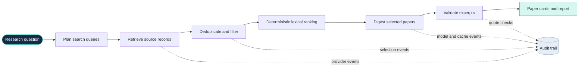

<div align="center">
  

  <p><strong>Literature review you can trace.</strong></p>
  <p>Find a focused set of papers, inspect what each source says, and follow every excerpt back to its record.</p>

  <p>
    
    
    
    
  </p>
</div>

---

## The idea

Literature discovery is useful only when researchers can inspect the source behind a summary. **TraceReview is a reading aid, not a scientific judge.** It retrieves and ranks papers, presents concise study summaries, checks proposed quotations against source text, and keeps workflow events visible in an audit trail.

> AI summaries and retrieval notes may miss nuance. Read the linked paper and decide what the findings mean. TraceReview does not determine whether a paper's conclusions are true and does not issue scientific verdicts.

## At a glance

<table>
  <tr>
    <td width="50%" valign="top">
      <h3>⌕ Discover</h3>
      Search PubMed and Europe PMC by default, with optional OpenAlex and Semantic Scholar adapters.
    </td>
    <td width="50%" valign="top">
      <h3>↗ Deduplicate</h3>
      Merge matching records by PMID, DOI, or normalized title while retaining alternate provider links.
    </td>
  </tr>
  <tr>
    <td width="50%" valign="top">
      <h3>❝ Trace excerpts</h3>
      Validate model-proposed quotations against source text; fall back to relevant abstract sentences verbatim when needed.
    </td>
    <td width="50%" valign="top">
      <h3>◷ Inspect the audit trail</h3>
      Review selection, provider, cache, quote-validation, and model-fallback events.
    </td>
  </tr>
  <tr>
    <td width="50%" valign="top">
      <h3>▤ Reuse digests</h3>
      Cache successful paper digests in PostgreSQL when the paper text, research question, and prompt version match.
    </td>
    <td width="50%" valign="top">
      <h3>◎ Keep scope visible</h3>
      Label records whose named organism differs from the organism in the question or research plan.
    </td>
  </tr>
</table>

## How it works



1. **Plan and retrieve.** The workflow plans queries and searches configured literature providers.
2. **Normalize and select.** Records are deduplicated; theses, dissertations, and short abstracts are filtered before ranking. The default run cap is 10 unique records, and the UI displays up to 10 paper cards.
3. **Prepare reading aids.** Selected records are digested in batches. Each card includes bibliographic details, a short AI-generated study summary, a neutral retrieval note, up to two source-matched key-finding excerpts, and the abstract's final sentence copied from the source record.
4. **Check and report.** HTML/XML markup is cleaned before display and quote validation. If proposed quotations do not match, relevant abstract sentences are selected verbatim. Successful digests can be cached; failed summaries remain visibly unreviewed.

## Paper cards are reading aids

Each selected record is presented with bibliographic metadata, source links, a concise summary of what the study did, and checked excerpts. The final sentence of the abstract is copied from the source record to make the authors' abstract conclusion easy to inspect.

TraceReview does **not** independently validate the scientific truth of a paper's claims, replace full-text reading, or turn retrieval into a scientific verdict. Retrieved titles, abstracts, and provider fields are treated as untrusted source data—not as instructions to the model.

## Technology

| Layer | Technologies |
| --- | --- |
| Frontend | React 19, TypeScript, Vite 6, Lucide React |
| API | Python 3.11+, FastAPI, Pydantic Settings, Uvicorn |
| Workflow | LangGraph; LangChain's Groq integration |
| Models | Groq GPT-OSS by default; optional OpenRouter free-router fallback |
| Literature sources | PubMed/NCBI, Europe PMC, OpenAlex, Semantic Scholar, Crossref; UniProt adapter available |
| Data | PostgreSQL 16 with pgvector, SQLAlchemy asyncio, asyncpg |
| Deployment | Docker Compose; optional Caddy HTTPS proxy |
| CI | GitHub Actions for lint, typing, tests, and image build |

**Ranking note:** ranking is currently deterministic and lexical. pgvector is installed and the schema can store embeddings, but the current workflow does not download or use an embedding model. Crossref is available as an adapter but is not enabled by default.

## Quick start with Docker

### 1. Configure the environment

Copy `.env.example` to `.env` and set `GROQ_API_KEY` plus a database password. Keep `POSTGRES_PASSWORD`, `DATABASE_URL`, and `DATABASE_URL_DOCKER` in sync; the Docker database URL uses `db` as its host.

`OPENROUTER_API_KEY`, `NCBI_API_KEY`, `CONTACT_EMAIL`, and `SEMANTIC_SCHOLAR_API_KEY` are optional. See `.env.example` for all settings.

> **Security:** Never commit `.env` or expose provider credentials in screenshots, logs, or public issues. URL-encode special characters in passwords embedded in database URLs.

### 2. Build and start

```powershell
docker compose up --build -d
```

### 3. Open TraceReview

| Service | URL |
| --- | --- |
| Web UI | [http://localhost:5173](http://localhost:5173) |
| API health | [http://localhost:8000/health](http://localhost:8000/health) |
| Interactive API docs | [http://localhost:8000/docs](http://localhost:8000/docs) |

Check service state and logs:

```powershell
docker compose ps
docker compose logs -f api frontend
```

The database lives in the `research_pgdata` Docker volume. `docker compose down` preserves it. Avoid `docker compose down -v` unless you intend to delete local database data.

## Configuration

The main settings are read from environment variables, usually through `.env`.

<details>
  <summary><strong>Model providers and throughput</strong></summary>

  - `GROQ_API_KEY`, `GROQ_MODEL`, `GROQ_REASONING_EFFORT`, and `GROQ_TPM_BUDGET` configure Groq.
  - `OPENROUTER_API_KEY` and `OPENROUTER_FALLBACK_MODEL` enable one independent digest fallback attempt.
  - Groq digest calls use a process-local concurrency limit and token budget. Long provider cooldowns are not retried in a loop.
  - If both model providers fail, the run records the issue and continues with whatever cards are available.
</details>

<details>
  <summary><strong>Sources and retrieval limits</strong></summary>

  - `NCBI_API_KEY`, `CONTACT_EMAIL`, and `SEMANTIC_SCHOLAR_API_KEY` are optional provider settings.
  - `MAX_RECORDS_PER_RESEARCH_RUN`, `MAX_PAPERS_PER_REVIEW`, `MIN_ABSTRACT_CHARS`, and `PAPER_DIGEST_BATCH_SIZE` control retrieval and review limits.
  - Search requests use bounded concurrency; PubMed calls are paced separately.
  - The workflow can expand retrieval once if too few cards are available. It does not broaden the search merely because a model failed to summarize a record.
</details>

<details>
  <summary><strong>Database connection</strong></summary>

  - `DATABASE_URL`, `DATABASE_URL_DOCKER`, and `POSTGRES_PASSWORD` configure database access.
  - The Docker URL should use `db` as the database hostname.
  - Back up the PostgreSQL volume before upgrades and migrations.
</details>

## API overview

| Method | Endpoint | Purpose |
| --- | --- | --- |
| `GET` | `/health` | API health check |
| `POST` | `/research` | Start a research run; returns a run ID immediately |
| `GET` | `/research/{id}` | Retrieve run details |
| `GET` | `/research/{id}/status` | Run status and progress |
| `GET` | `/research/{id}/plan` | Research objective and search plan |
| `GET` | `/research/{id}/sources` | Retrieved records and attached paper summaries |
| `GET` | `/research/{id}/report` | Report JSON; use `?format=markdown` for Markdown output |
| `GET` | `/research/{id}/audit` | Workflow events and provider/model diagnostics |

Legacy evidence and claims endpoints remain for compatibility with older stored runs. New research runs use paper cards and do not generate or verify claims.

## Local development

Run the backend checks from the repository root in PowerShell:

```powershell
python -m venv .venv
.\.venv\Scripts\Activate.ps1
pip install -e ".[dev]"
ruff check src tests
mypy src
pytest -q
```

Start the API in one terminal:

```powershell
uvicorn auditable_research.api:app --app-dir src --reload
```

Start the frontend in another terminal:

```powershell
cd frontend
npm install
npm run dev
```

The frontend runs at [http://localhost:5173](http://localhost:5173). Set `VITE_API_BASE_URL` if the API is hosted elsewhere.

## Production deployment

`docker-compose.prod.yml` adds Caddy as an HTTPS reverse proxy. The target is a Linux VM with Docker Compose v2.24 or newer, DNS records for the UI and API domains pointing to the VM, and inbound TCP ports 80 and 443 open.

Configure `UI_DOMAIN`, `API_DOMAIN`, strong database credentials, and model credentials in the VM's `.env`, then run:

```bash
docker compose -f docker-compose.yml -f docker-compose.prod.yml up -d --build
```

Rate limiting is per client IP. The production compose file sets `FORWARDED_ALLOW_IPS=*` so Uvicorn reads the real client address from Caddy's `X-Forwarded-For` header. This is safe only while the API port is not published and Caddy is the sole entry point. If the API is exposed directly, remove that setting or the forwarded header could be spoofed.

### Current operational limits

- Research runs execute inside the API process. If the API restarts mid-run, the run cannot resume; startup marks runs still `queued` or `running` as `failed`, with an explanatory message, so they can be restarted.
- The initial deployment targets one API container. Background jobs and rate limits are process-local; add a durable job queue and shared limiter before scaling to multiple API replicas.
- Back up the PostgreSQL volume before applying upgrades or migrations.

## Project principles

- **Source before summary:** paper records and source excerpts remain inspectable.
- **Verbatim means verbatim:** excerpts are checked against the cleaned source text.
- **Failures stay visible:** failed digests do not silently become scientific findings.
- **Retrieval is not verification:** TraceReview helps researchers read literature; it does not decide what is true.

---

<div align="center">
  <sub>TraceReview · Discover carefully. Read critically. Trace every excerpt.</sub>
</div>
